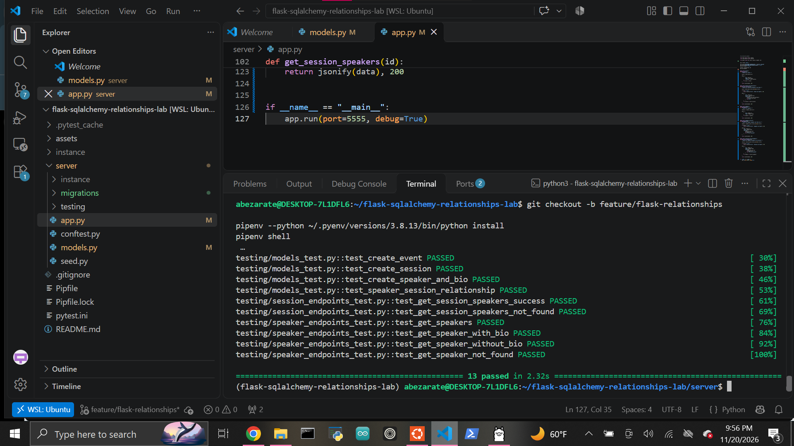

# Modeling Relationships in Flask-SQLAlchemy

This project demonstrates how to model and query relational data using Flask, Flask-SQLAlchemy, and Flask-Migrate.

The application represents an event-management system containing events, sessions, speakers, and speaker biographies.

## Models and Relationships

The database includes four main models:

### Event

- `id`
- `name`
- `location`
- Has many Sessions

Deleting an Event also deletes its associated Sessions.

### Session

- `id`
- `title`
- `start_time`
- `event_id`
- Belongs to an Event
- Has many Speakers through the `session_speakers` association table

### Speaker

- `id`
- `name`
- Has one Bio
- Has many Sessions through the `session_speakers` association table

Deleting a Speaker also deletes the associated Bio.

### Bio

- `id`
- `bio_text`
- `speaker_id`
- Belongs to a Speaker

## Relationship Types

This project demonstrates three common relational database patterns:

- **One-to-Many:** Event → Sessions
- **One-to-One:** Speaker → Bio
- **Many-to-Many:** Sessions ↔ Speakers

The many-to-many relationship is implemented using the `session_speakers` association table.

## API Endpoints

### Events

`GET /events`

Returns all events.

`GET /events/<id>/sessions`

Returns all sessions associated with a specific event.

If the event does not exist:

```json
{
  "error": "Event not found"
}
```

### Speakers

`GET /speakers`

Returns all speakers.

`GET /speakers/<id>`

Returns a specific speaker and their biography.

If a speaker does not have a biography, the response contains:

```json
{
  "bio_text": "No bio available"
}
```

If the speaker does not exist:

```json
{
  "error": "Speaker not found"
}
```

### Sessions

`GET /sessions/<id>/speakers`

Returns all speakers associated with a specific session, including available biography information.

If the session does not exist:

```json
{
  "error": "Session not found"
}
```

## Setup

Install the dependencies:

```bash
pipenv install
pipenv shell
```

Move into the server directory:

```bash
cd server
```

Configure Flask:

```bash
export FLASK_APP=app.py
export FLASK_RUN_PORT=5555
```

## Database Setup

Apply the existing database migrations:

```bash
flask db upgrade head
```

Seed the database:

```bash
python seed.py
```

## Run the Application

From the `server` directory:

```bash
flask run
```

The application runs on port `5555`.

## Testing

Run the full test suite from the `server` directory:

```bash
pytest -v
```

The completed implementation passes all 13 tests covering:

- SQLAlchemy models and relationships
- Event endpoints
- Speaker endpoints
- Session endpoints

## Test Results

